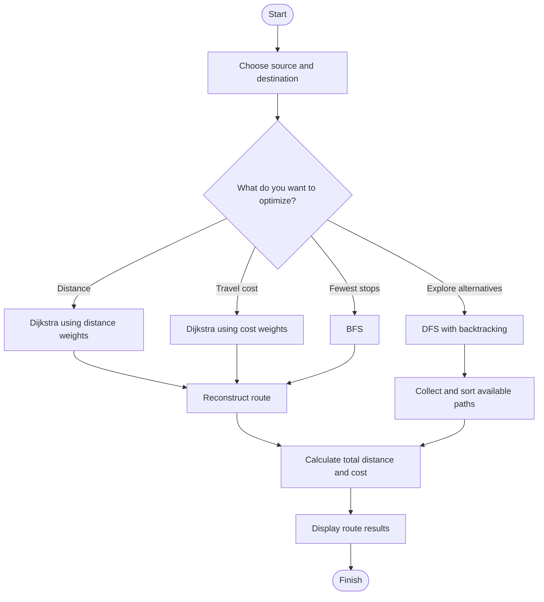
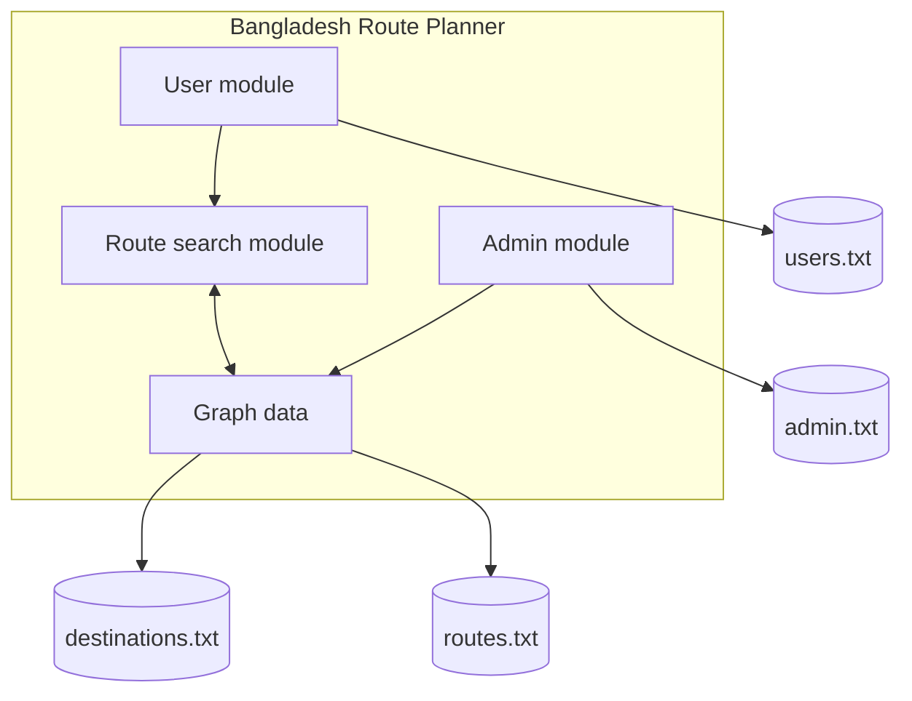

<div align="center">

# 🧭 Bangladesh Route Planner

### A C-based console application for exploring routes across Bangladesh

<p>
  
  
  
  
</p>

**Plan routes. Compare travel options. Explore graph algorithms.**

</div>

---

## 📌 Overview

**Bangladesh Route Planner** is a menu-driven console application developed in **C (C99)**. It models selected destinations in Bangladesh as a weighted, undirected graph and helps users explore possible routes using graph traversal and shortest-path algorithms.

The project also includes user registration and login, profile management, and an admin panel for managing users, destinations, and route information.

> **Project note:** Route distances and costs are sample values for academic demonstration. They are not live transport fares, official road measurements, or real-time navigation data.

## ✨ Key Features

| Feature | What it does |
|---|---|
| 👤 User accounts | Register, log in, and manage a user profile |
| 🛡️ Admin panel | Manage users, destinations, routes, and admin credentials |
| 🗺️ Route management | Add, view, update, and delete route information |
| 🔎 Route exploration | Find possible paths between selected destinations |
| 💰 Cost-based route | Find a minimum-cost route using Dijkstra's algorithm |
| 📏 Distance-based route | Find a shortest-distance route using Dijkstra's algorithm |
| 🚏 Fewest-stop route | Find a route with the fewest edges using BFS |
| 📊 Route comparison | Compare available paths by distance |

## 🧠 Algorithms at a Glance

| Algorithm | Purpose | Typical complexity in this project |
|---|---|---|
| **Dijkstra** | Minimum distance or minimum cost | `O(V²)` |
| **BFS** | Route with the fewest stops/edges | `O(V²)` |
| **DFS + Backtracking** | Enumerate possible simple paths | Worst case: exponential |
| **Sorting** | Sort stored paths by distance | `O(P log P)` average |

`V` = number of destinations; `P` = number of stored paths.

### How route selection works



## 🗺️ Destinations Included

The application starts with 12 sample destinations:

<div align="center">

| | | |
|:---:|:---:|:---:|
| Dhaka | Chattogram | Cox's Bazar |
| Sylhet | Rajshahi | Jashore |
| Khulna | Barishal | Cumilla |
| Mymensingh | Bogura | Rangpur |

</div>

The default graph includes 19 sample road connections. Admin functions allow the destination and route data to be managed from the application.

## 🏗️ Technical Design

### Graph representation

The road network is represented with two adjacency matrices:

- `distMatrix[MAX_DEST][MAX_DEST]` stores distance weights.
- `costMatrix[MAX_DEST][MAX_DEST]` stores cost weights.
- A value of `0` represents no direct road between two different destinations.
- Connections are stored symmetrically because the graph is undirected.



### Main structures and limits

| Item | Purpose |
|---|---|
| `User` | Stores user information |
| `Path` | Stores a discovered route and its totals |
| `distMatrix` | Stores road-distance weights |
| `costMatrix` | Stores road-cost weights |
| `MAX_DEST = 30` | Maximum destination capacity |
| `MAX_USERS = 200` | Maximum user capacity |
| `MAX_STORED_PATHS = 2000` | Maximum stored paths |

### Data files

| File | Purpose |
|---|---|
| `users.txt` | Registered user records |
| `admin.txt` | Admin credential data |
| `destinations.txt` | Destination data |
| `routes.txt` | Road connection data |

At startup, the application loads admin credentials, users, and graph data from these files.

## ⚙️ Getting Started

### Requirements

- GCC or another C compiler that supports C99
- Windows, Linux, or macOS terminal
- A code editor such as Visual Studio Code (optional)

### 1. Clone the repository

Replace the URL below with your actual GitHub repository URL:

```bash
git clone https://github.com/eastiak14/Bangladesh-Route-Planner.git
cd Bangladesh-Route-Planner
```

### 2. Compile

If your source file is named `route_planner.c`:

**Linux / macOS**
```bash
gcc -std=c99 -Wall -Wextra route_planner.c -o route_planner
```

**Windows (MinGW GCC)**
```bash
gcc -std=c99 -Wall -Wextra route_planner.c -o route_planner.exe
```

If your C file has a different name, replace `route_planner.c` with that filename.

### 3. Run

**Linux / macOS**
```bash
./route_planner
```

**Windows**
```bash
route_planner.exe
```

## 🕹️ How to Use

1. Run the program.
2. Choose the user or admin option from the main menu.
3. Register a user account if you are a new user.
4. Log in to access the available features.
5. Select a route-related option and enter the source and destination.
6. Choose the route strategy: minimum distance, minimum cost, fewest stops, or alternative path exploration.
7. Review the displayed route and its calculated totals.

Admin access provides options to manage registered users, destinations, routes, and admin credentials.

## 📁 Suggested Repository Structure

```text
Bangladesh-Route-Planner/
│
├── route_planner.c
├── README.md
├── .gitignore
│
└── assets/
    ├── main-menu.png
    ├── user-panel.png
    └── route-result.png
```

The `assets/` screenshots are optional. Add your own screenshots before using these paths in the README; no screenshots are included by default.

## 🔐 Security and Data Notes

- Do not upload personal user records or real admin credential files to a public repository.
- The current custom password-hashing approach is for academic demonstration only; it is not a substitute for a modern, vetted password-hashing library.
- Keep runtime data files out of Git if they contain real account information.
- The project does not connect to live GPS, online maps, traffic services, or a remote database.

## ⚠️ Current Limitations

- Route distance and cost values are sample data.
- The application is a console-based academic project, not a commercial navigation system.
- DFS path enumeration can become expensive as the graph grows; stored results are capped.
- Adjacency-matrix operations use `O(V²)` space, and Dijkstra/BFS implementations have `O(V²)` time complexity in this project.

## 🎓 Learning Outcomes

This project demonstrates practical use of:

- C programming and modular program design
- Structures, arrays, functions, and file handling
- Graph representation with adjacency matrices
- BFS, DFS, recursion, and backtracking
- Dijkstra's shortest-path algorithm
- Sorting and route comparison
- Basic user and admin workflows

## 👥 Project Team
<div align="center">
| Member |
|---|
| Eastiak Remon |
| Faria Tabassum (Ruhi) |
| Shahriar Hasan Siam |
| Sabbir Hossain |
| Salauddin Ahmed|
</div>

## 🤝 Contributions

Suggestions, bug reports, and improvements are welcome. If you want to contribute, fork the repository, create a branch, make your changes, and open a pull request.


---

<div align="center">

**Made for learning, problem-solving, and exploring graph algorithms.**


</div>
